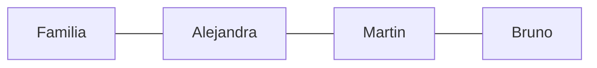

[[Libros]]
# Contenido

Puntos
- El dragón y la princesa
- Los rostros invisibles
- Informe sobre ciegos
- Un Dios desconocido 
# Citas

Qué misterioso es el mundo. Solamente la gente superficial no lo ve. Conversas con el vigilante de la esquina, le tomas confianza, y al rato descubrís que él también es un misterio.

El triunfo siempre tiene algo de vulgar y de horrible… Lo que sería de este país, si todo el mundo triunfase! No quiero ni pensarlo. Nos salva un poco el fracaso de tanta gente.

Por desgracia, la vida la hacemos en borrador. Un escritor puede ser algo imperfecto y tirarlo a la basura. La vida no: lo que se ha vivido, no hay forma de corregirlo.

La obra de arte es un intento, acaso descabellado, la infinita realidad entre dos límites de un cuadro o de un libro. 

La única forma de mantener la paz entre los seres humanos es mediante la ignorancia recíproca y el desconocimiento, únicas condiciones en que estos bichos son relativamente bondadosos y justicieros, ya que todos somos bastante ecuánimes con relación a cosas que no nos interesan. 

El talento para seducir a alguien cuando se lo proponía, talento, que era favorable por su completa, falta de sinceridad y de Honestidad … No logras producir esa promesa de encantamiento absoluto, que pueden alcanzar los cínicos y mentirosos. 
# Reflexiones
# Personajes

